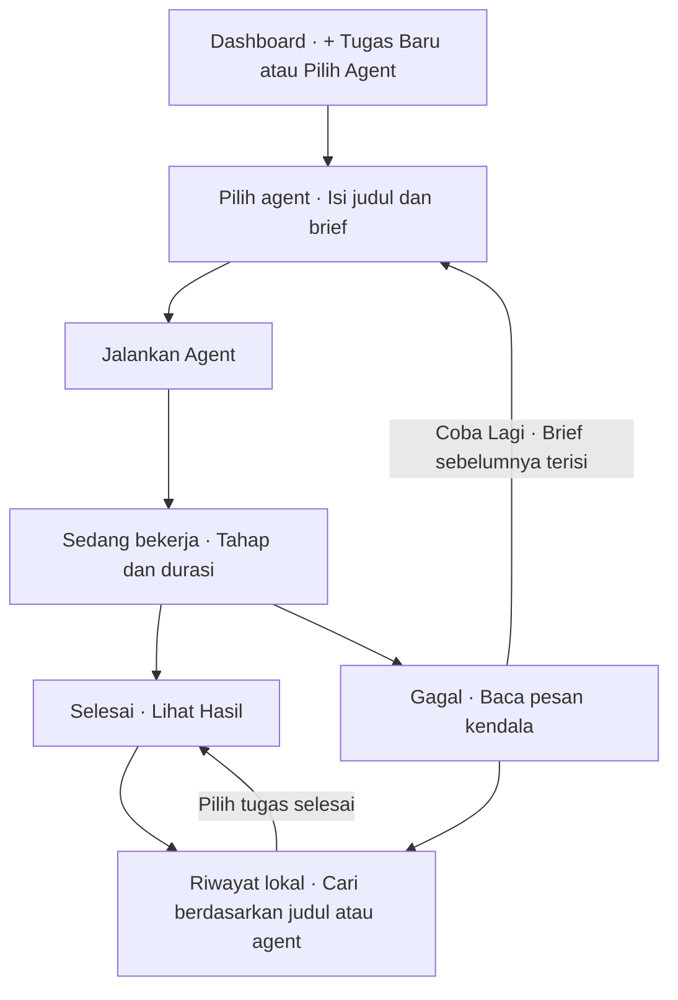

# Product Requirements Document

**Corporate Agent Desk · MVP Windows**

Versi 1.1 · 8 November 2026

## Tujuan produk

Membantu pimpinan dan anggota Corporate Team menyiapkan bahan keputusan, rencana kerja tim, dan proposal kerja sama dari satu dashboard. Pengguna dapat melihat agent mana yang sedang bekerja, menunggu hasil tanpa mengirim brief yang sama lagi, dan meninjau hasil sebelum menggunakannya.

### Pengguna dan kebutuhan

| Pengguna | Pekerjaan utama |
|---|---|
| Pimpinan Corporate Team | Membandingkan opsi, melihat risiko, dan mengambil keputusan dengan alasan yang terdokumentasi. |
| Koordinator tim | Membagi pekerjaan, menentukan PIC dan tenggat, serta mengidentifikasi benturan kapasitas. |
| Penanggung jawab kemitraan | Menyiapkan penawaran dan proposal berdasarkan kebutuhan mitra serta komitmen yang telah disetujui. |

## Agent dan hasil

| Agent | Informasi yang membantu | Hasil minimum |
|---|---|---|
| **Decision Analyst** | Tujuan keputusan, opsi, kriteria, biaya, batasan, dan tenggat. | Perbandingan opsi, dampak dan risiko, rekomendasi beserta alasan, serta poin yang perlu diputuskan. |
| **People Operations** | Daftar pekerjaan, kapasitas tim, PIC yang tersedia, prioritas, dan tenggat. | Rencana kerja dengan usulan PIC, tenggat, konflik kapasitas, dan tindak lanjut. |
| **Partnership & Proposal** | Kebutuhan mitra, ruang lingkup, anggaran, jadwal, dan batas komitmen. | Draf penawaran dengan ruang lingkup, deliverables, jadwal, harga jika tersedia, dan poin persetujuan. |

Setiap agent menggunakan informasi yang tersedia di brief dan menandai asumsi atau data yang masih perlu dikonfirmasi. Pengguna bertanggung jawab meninjau hasil, menetapkan keputusan terkait karyawan, menyetujui harga dan komitmen, serta mengirim materi kepada mitra.

## Alur pengguna

1. Buka dashboard. Klik **+ Tugas Baru** di kanan atas atau **Pilih Agent** pada kartu agent.
2. Pilih agent, isi judul dan brief, lalu klik **Jalankan Agent** di kanan bawah formulir.
3. Lihat kartu tugas di panel **Aktivitas**. Selama proses berlangsung, kartu menampilkan **Sedang bekerja**, indikator berputar, tahap proses, dan durasi berjalan.
4. Saat tugas selesai, klik **Lihat Hasil** atau temukan kembali tugas melalui pencarian riwayat. Jika gagal, klik **Coba Lagi** untuk membuka formulir dengan agent, judul, dan brief sebelumnya.

## Persyaratan fungsional

| ID | Persyaratan MVP |
|---|---|
| FR-01 | Dashboard menampilkan tiga kartu agent. Tombol **+ Tugas Baru** berada di kanan atas. Tombol **Pilih Agent** pada setiap kartu membuka formulir dengan agent tersebut sudah terpilih. |
| FR-02 | Formulir mewajibkan agent, judul hingga 100 karakter, dan brief hingga 8.000 karakter. **Batal** dan **Jalankan Agent** berada di bagian bawah formulir, dengan tombol utama di kanan. |
| FR-03 | Satu agent menangani maksimal satu tugas aktif. Agent yang berbeda dapat bekerja bersamaan. Sistem menolak tugas kedua untuk agent yang masih aktif dan menjelaskan alasannya. |
| FR-04 | Panel **Aktivitas** menampilkan tugas aktif di atas riwayat. Setiap kartu menunjukkan judul, nama agent, waktu mulai, dan status. Ringkasan dashboard menunjukkan jumlah agent yang sedang bekerja. |
| FR-05 | Status mengikuti proses Codex. Saat tugas aktif, kartu menunjukkan indikator berputar dan durasi dalam format menit:detik. Label tahap mengikuti peristiwa yang diterima dari proses. Durasi mengukur waktu yang berlalu. |
| FR-06 | Saat Codex selesai dengan hasil teks, status berubah menjadi **Selesai** dan tombol **Lihat Hasil** membuka hasil dengan opsi **Salin Hasil**. |
| FR-07 | Jika proses gagal, melewati batas 5 menit, atau terputus saat aplikasi berhenti, kartu menunjukkan **Gagal**, pesan kendala, dan tombol **Coba Lagi**. Formulir terisi dengan brief yang tersimpan. |
| FR-08 | Jika koneksi ke server lokal terputus, dashboard menampilkan pesan koneksi dan kembali memperbarui status setelah tersambung. |
| FR-09 | Judul, brief, status, dan hasil tersimpan di komputer dan tersedia kembali setelah aplikasi ditutup dan dibuka. |
| FR-10 | Pengguna dapat mencari riwayat berdasarkan judul atau agent, menyaring tugas selesai atau gagal, dan menampilkan lebih banyak hasil. Tugas aktif tetap terlihat. |

### Aturan status

| Status | Kapan ditampilkan | Aksi pengguna |
|---|---|---|
| **Sedang bekerja** | Server sudah menerima tugas dan proses masih berjalan. Tahap dapat berupa **Memulai Codex**, **Mengerjakan brief**, atau **Menyiapkan hasil**. | Pantau indikator dan durasi. Agent lain yang tersedia dapat menerima tugas. |
| **Selesai** | Proses selesai dengan sukses dan mengembalikan hasil teks. | **Lihat Hasil**, lalu **Salin Hasil**. |
| **Gagal** | Proses gagal dijalankan, berhenti tanpa hasil, atau melewati batas waktu. | Baca pesan kendala dan klik **Coba Lagi**. |

## Persyaratan operasional dan aksesibilitas

- MVP berjalan di Windows melalui Node.js dan Codex CLI. Server hanya menerima koneksi lokal. Pemrosesan brief menggunakan sesi Codex pengguna.
- Status memakai teks yang terbaca. Indikator berputar berhenti bergerak bila pengguna mengaktifkan pengaturan pengurangan animasi. Tombol dan formulir dapat diakses dengan keyboard.
- Di layar sempit, panel **Aktivitas** berada di bawah daftar agent. Setelah tugas berhasil dikirim, aplikasi mengarahkan tampilan ke panel tersebut.
- Riwayat disimpan di folder lokal profil pengguna Windows. **Salin Hasil** tersedia untuk memindahkan keluaran ke dokumen lain.

## Kriteria penerimaan

| ID | Skenario | Lulus jika |
|---|---|---|
| AC-01 | Buka dashboard dan pilih salah satu kartu agent. | Tombol utama terlihat di kanan atas. Formulir terbuka dengan pilihan agent yang benar. |
| AC-02 | Kirim brief fiktif yang valid. | Kartu muncul di panel **Aktivitas** dengan **Sedang bekerja**. Selama proses masih aktif, indikator dan durasi terlihat tanpa perlu memuat ulang. |
| AC-03 | Mulai tugas kedua untuk agent yang masih aktif, lalu mulai tugas untuk agent berbeda. | Tugas ganda untuk agent yang sama ditolak. Agent yang tersedia bisa berjalan bersamaan. |
| AC-04 | Tunggu hasil dari tiap agent. | Kartu berubah menjadi **Selesai**. Hasil dapat dibuka dan disalin serta mengikuti peran agent yang dipilih. |
| AC-05 | Simulasikan proses gagal atau melewati batas waktu. | Kartu berubah menjadi **Gagal**, menampilkan pesan, dan membuka formulir **Coba Lagi** dengan judul dan agent yang sesuai. |
| AC-06 | Mulai ulang server setelah satu tugas selesai dan satu tugas masih berjalan. | Hasil tugas selesai tetap tersedia. Tugas yang terputus ditandai gagal dan brief sebelumnya dapat dibuka lewat **Coba Lagi**. |
| AC-07 | Uji pada layar sempit dan dengan keyboard. | Tombol utama, formulir, kartu aktivitas, dan hasil dapat dijangkau. Status tetap terbaca dengan pengurangan animasi aktif. |
| AC-08 | Cari judul atau nama agent, lalu pilih filter status. | Riwayat menampilkan tugas yang cocok dan tugas aktif tetap terlihat. |

Pengujian awal menggunakan brief fiktif Decision Analyst telah mengonfirmasi respons dashboard dan perubahan status proses dari berjalan ke selesai dengan hasil memo. Tabel di atas adalah kriteria penerimaan untuk pengujian produk secara menyeluruh.
